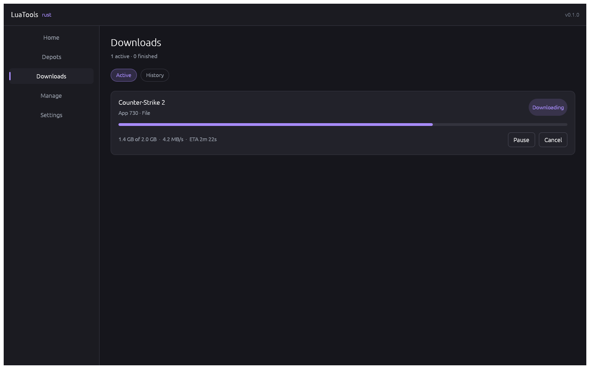
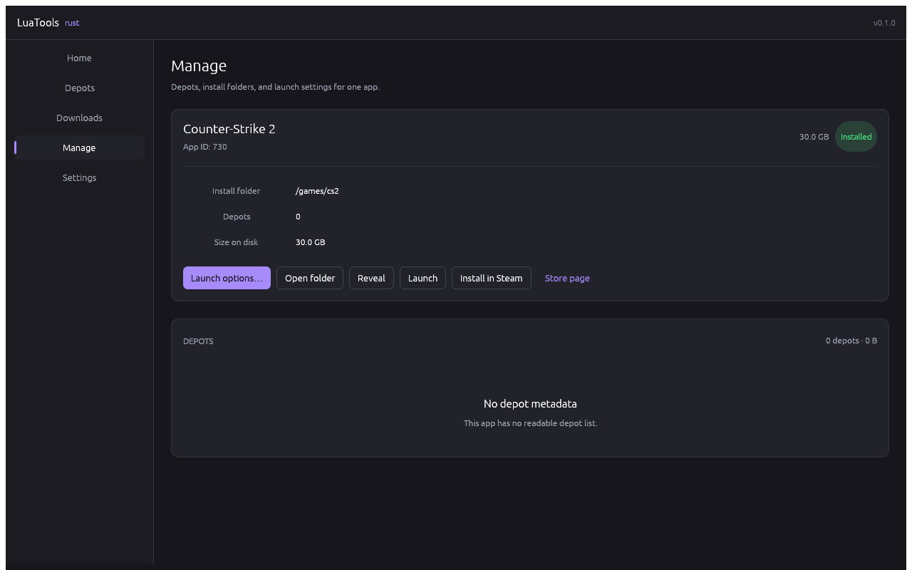
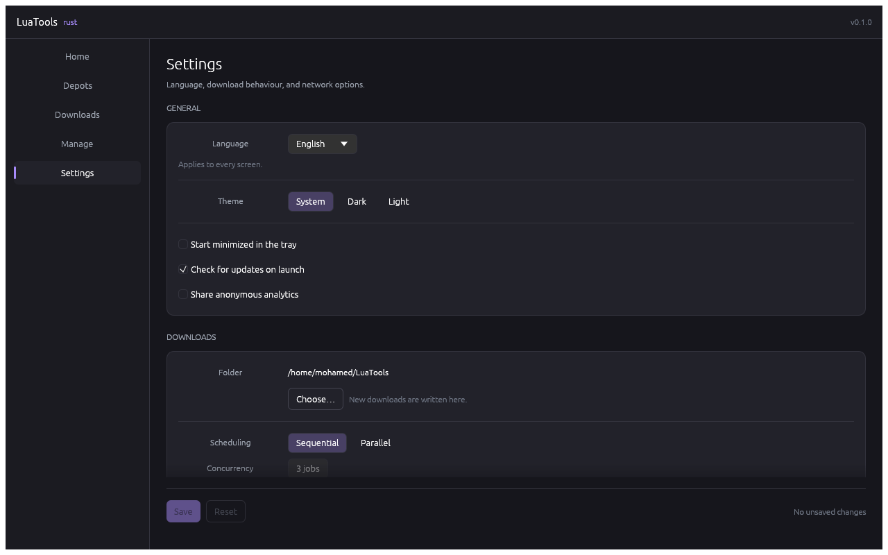

# LuatoolsRS

A Rust rewrite of [LuaTools](https://github.com/madoiscool/LuaTools) — a desktop client for
inspecting Steam libraries, managing depot metadata, editing launch options, and transferring
files — with a GPU-rendered interface built on `egui`/`eframe` (wgpu).

> **Scope note.** This rewrite covers the legitimate Steam client features only. The original
> application's Steam DRM circumvention features (stplug-in ownership spoofing, unlocker mode
> backends, SteamAutoCrack, Steamless/SteamStub removal, Denuvo fixes, DLC entitlement
> generation, third-party manifest-source catalogs, depot-key donation) are deliberately not
> ported.

## Screenshots

| Home | Depots |
|---|---|
|  |  |

| Downloads | Manage |
|---|---|
|  |  |



These are rendered by the real UI code through offscreen wgpu, not mockups.

## Status

| Area | Status |
|---|---|
| Steam library discovery (`libraryfolders.vdf`, `appmanifest_*.acf`) | working, including extra library roots |
| Text and binary VDF, `appinfo.vdf`, zipped depot manifests, depot-key format checks | working |
| Store catalogue: search, featured strips, details, covers, metadata filters | working (Add page) |
| Depot metadata: sizes, public manifests/builds, OS, language, DLC, shared depots | working |
| Launch options: appinfo entries + localconfig, add/remove/reorder, backup/restore | working; Steam is stopped/restarted when appinfo is rewritten |
| Download queue: pause, resume, cancel, retry, history, verify, speed limit | working for file URLs; destination is the configured download folder |
| App install/update hand-off | opens `steam://install/<id>` and the store page |
| Multi-language UI (English + 29 translations) | typed locale keys throughout; newer labels fall back to English when no translation exists |
| Settings, cache, atomic persistence, single instance, protocol registration/handoff | working |
| Tray icon, close-to-tray, start minimized, start with the OS | working (tray backend is native on each platform) |
| Updater | checks GitHub releases and stages the platform asset; installation is left to the package manager |
| Steam store plugin | Windows installer/manager, Plugin page, CEF store-page injection, loopback plugin API with three routes |
| Authentication | configurable Supabase/Discord PKCE flow; guest mode when unconfigured |
| System fonts | CJK, Thai and Arabic fallbacks loaded from the OS |
| Native folder picker | XDG portal on Linux, native dialogs on Windows/macOS |
| Themes | dark by default; light palette available |

Known limitations: Arabic is rendered left-to-right without joining (egui has no text shaping);
depot-content downloads are out of scope (the app hands installs to Steam, and its download
queue transfers plain files); the Steam plugin loader is Windows-only; updates are staged for a
package manager rather than self-installed; sign-in needs `LUATOOLS_SUPABASE_URL` and
`LUATOOLS_SUPABASE_ANON_KEY` at runtime; queue-wide verification/speed/concurrency and the local
API port take effect on the next launch. On Linux, close-to-tray needs a StatusNotifier/
AppIndicator host; without one the tray icon will not appear.

## Layout

```
crates/
  luatools-core       domain types, Command/Event contract, settings, paths, cache, hashing
  luatools-steam      VDF, appinfo, ACF, manifests, libraries, launch options, links
  luatools-net        HTTP, DoH, GitHub mirrors, API client, auth, updater, plugin server
  luatools-downloads  download queue actor, transfers, history
  luatools-i18n       typed keys and 29 compiled locale tables
  luatools-ui         egui theme, widgets, pages, shell
  luatools-app        entry point, backend actor, single instance, logging
```

## Build

Requires Rust 1.95+ (2024 edition).

```sh
cargo build --release -p luatools-app
cargo test --workspace
cargo clippy --workspace --all-targets -- -D warnings
cargo fmt --all --check
```

The GPU backend is wgpu through eframe. On Linux, `x11` and `wayland` features are enabled; on
Windows the app uses D3D12 through wgpu.

## Architecture

The interface is immediate mode and stateless with respect to backend/network I/O. It renders
from `AppState`, sends `Command` values through a channel, and folds `Event` values back into
state each frame. It only reads local cover images and dropped files. The backend actor owns
the Tokio runtime, the Steam probing, the network, and the download queue. Network work never
blocks the UI thread, and every screen is testable with a disconnected handle.

See `docs/port-spec.md` for the module contracts and `docs/egui-0.37-api.md` for the UI API
cheat-sheet used by the port.

## Licence

MIT. The original LuaTools is MIT-licensed; this rewrite keeps the same licence and attribution.
