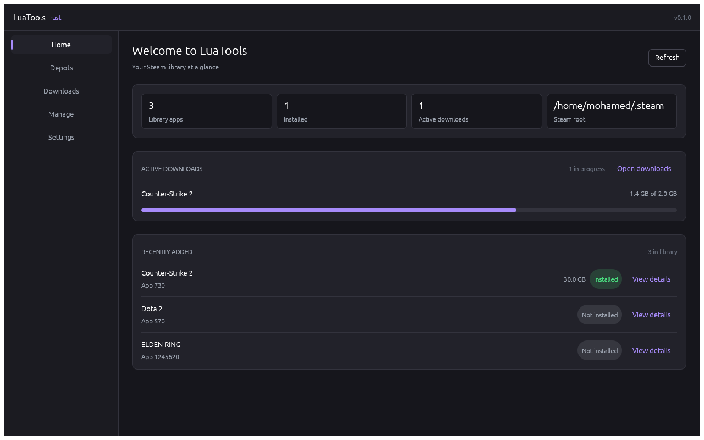
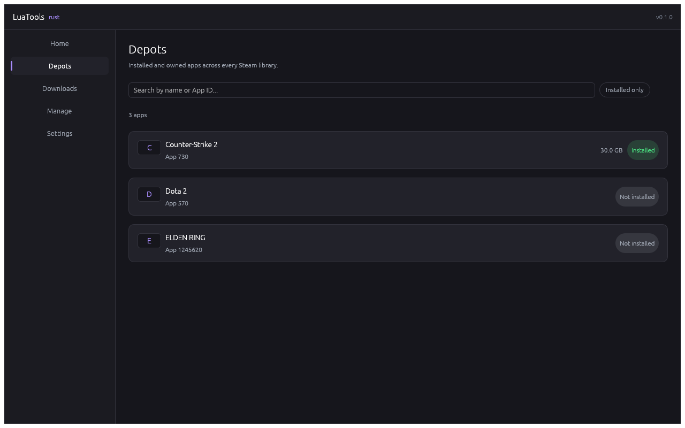

# LuaTools (Rust)

A Rust rewrite of [LuaTools](https://github.com/madoiscool/LuaTools) — a desktop client for
inspecting Steam libraries, managing depot metadata, editing launch options, and downloading
content you own — with a GPU-rendered interface built on `egui`/`eframe` (wgpu).

> **Scope note.** This rewrite covers the legitimate Steam client features only. The original
> application's Steam DRM circumvention features (stplug-in ownership spoofing, unlocker mode
> backends, SteamAutoCrack, Steamless/SteamStub removal, Denuvo fixes, DLC entitlement
> generation, third-party manifest-source catalogs, depot-key donation) are deliberately not
> ported.

## Screenshots

| Home | Depots |
|---|---|
|  |  |

| Downloads | Manage |
|---|---|
|  |  |


These are rendered by the real UI code through offscreen wgpu, not mockups.

## Status

| Area | Status |
|---|---|
| Steam library discovery (`libraryfolders.vdf`, `appmanifest_*.acf`) | working |
| Text and binary VDF, `appinfo.vdf`, depot manifest parsing | working |
| Launch options: read from appinfo/localconfig, edit, apply | writes `localconfig.vdf` (backup kept); restart Steam |
| Download queue: pause, resume, cancel, retry, history | working for file URLs |
| App install/update hand-off | opens `steam://install/<id>` and the store page |
| Steam store search / app metadata client | implemented, not surfaced in the UI yet |
| Multi-language UI (English + 29 translations) | working |
| Settings, cache, atomic persistence, single instance, protocol handoff | working |
| Updater check (GitHub releases) | check only; installation is package-manager work |
| Millennium/Steam store plugin installer | trait + server surface; platform installer not implemented |
| Local plugin API server | loopback + token, three routes |
| Tray icon | not implemented; the window closes normally |
| System fonts | CJK, Thai and Arabic fallbacks loaded from the OS |
| Native folder picker | XDG portal on Linux, native dialogs on Windows/macOS |
| Themes | dark by default; light palette available |

Known limitations: Arabic is rendered left-to-right without joining (egui has no text shaping);
the Steam plugin installer and tray are not implemented; depot-content downloads are out of
scope (the app hands installs to Steam, and its download queue transfers plain files).

## Layout

```
crates/
  luatools-core       domain types, Command/Event contract, settings, paths, cache, hashing
  luatools-steam      VDF, appinfo, ACF, manifests, libraries, launch options, links
  luatools-net        HTTP, DoH, GitHub mirrors, API client, auth, updater, plugin server
  luatools-downloads  download queue actor, transfers, history
  luatools-i18n       typed keys and 29 compiled locale tables
  luatools-ui         egui theme, widgets, pages, shell
  luatools-app        entry point, backend actor, single instance, logging
```

## Build

Requires Rust 1.95+ (2024 edition).

```sh
cargo build --release -p luatools-app
cargo test --workspace
cargo clippy --workspace --all-targets -- -D warnings
cargo fmt --all --check
```

The GPU backend is wgpu through eframe. On Linux, `x11` and `wayland` features are enabled; on
Windows the app uses D3D12 through wgpu.

## Architecture

The interface is immediate mode and stateless with respect to I/O. It renders from `AppState`,
sends `Command` values through a channel, and folds `Event` values back into state each frame.
The backend actor owns the Tokio runtime, the Steam probing, the network, and the download
queue. Nothing blocks the UI thread, and every screen is testable with a disconnected handle.

See `docs/port-spec.md` for the module contracts and `docs/egui-0.37-api.md` for the UI API
cheat-sheet used by the port.

## Licence

MIT. The original LuaTools is MIT-licensed; this rewrite keeps the same licence and attribution.
